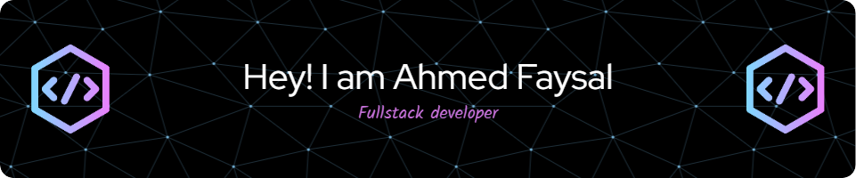
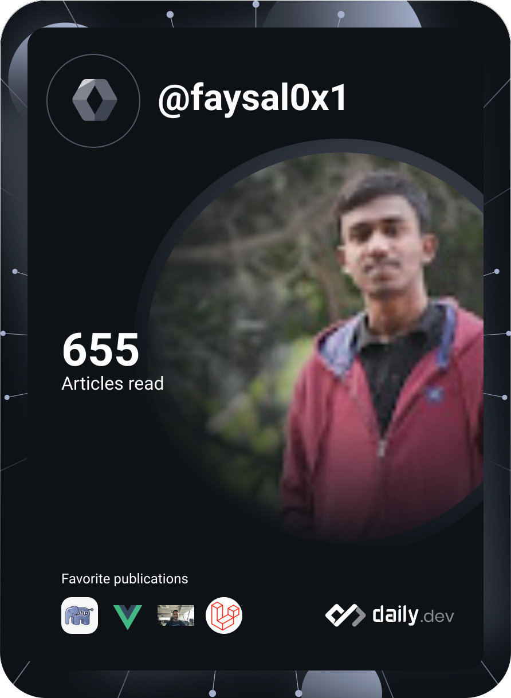
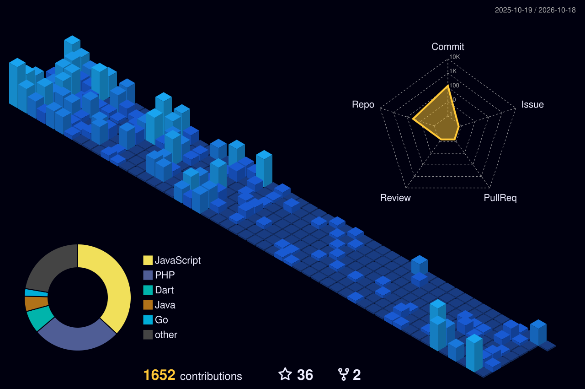
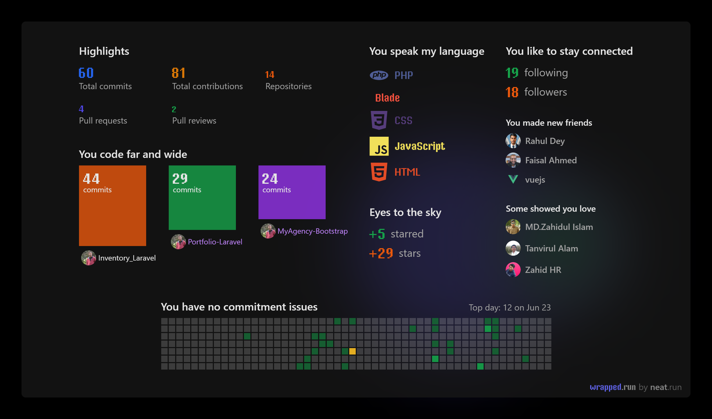

# Hi My name is Ahmed Faysal

## Laravel Developer , A Web Artisan

<p style="font-size:15px;font-weight:400;"> 
<!--  -->
<!-- <a href="https://app.daily.dev/faysal0x1"></a> -->
<a href="https://app.daily.dev/faysal0x1"></a>

<div style="margin-top:5rem;">
<p>🌍  I'm based in Bangladesh</p>
 <p>🖥️  See my portfolio at [here](http://faysalswe.com)</p>
 <p>✉️  You can contact me at <a mailto:faysalk461@gmail.com>
<b> faysalk461@gmail.com</b> </a> ()
 </p>
<p> 🧠  I'm learning Nuxt Js</p>
<p> 🤝  I'm open to collaborating on Laravel related projects</p>
</p>
</div>

<div  style="display:flex;  margin:2px;">
<div style="display:flex;  margin-right:5px;"><a margin="2px" href="https://www.github.com/faysal0x1" target="_blank" rel="noreferrer">
  
</a></div>
<div>
<a href="https://www.twitter.com/faysal0x1" target="_blank" rel="noreferrer">
  
</a>

</div>

</div>

<br>
<br>
<br>
<br>
<br>

<br>

---

<div align="center">
  <h3 styele="font-weight:900" bold>Profile Views :</h3>
  
</div>

## My Skill Set

<table><tr><td valign="top" width="33%">

### Frontend

<div align="center">  
<a href="https://en.wikipedia.org/wiki/HTML5" target="_blank"></a>  
<a href="https://www.w3schools.com/css/" target="_blank"></a>  
<a href="https://www.javascript.com/" target="_blank"></a>  
<a href="https://jquery.com/" target="_blank"></a>  
<a href="https://www.chartjs.org/" target="_blank"></a>  
<a href="https://vuejs.org/" target="_blank"></a>  
</div>

</td><td valign="top" width="33%">

### Backend

<div align="center">  
<a href="https://www.php.net/" target="_blank"></a>  
<a href="https://www.apachefriends.org/" target="_blank"></a>  
<a href="https://laravel.com/" target="_blank"></a>  
<a href="https://www.mysql.com/" target="_blank"></a>  
<a href="https://redis.io/" target="_blank"></a>  
</div>

</td><td valign="top" width="33%">

### Others

<div align="center">  
<a href="https://www.linux.org/" target="_blank"></a>  
<a href="https://github.com/" target="_blank"></a>  
<a href="https://www.figma.com/" target="_blank"></a>  
</div>

</td></tr></table>

<br/>

## Connect with me

<div align="center">
<a href="https://github.com/faysal0x1" target="_blank">

</a>
<a href="https://twitter.com/faysal0x1" target="_blank">

</a>
<a href="https://dev.to/faysal0x1" target="_blank">

</a>
<a href="https://linkedin.com/in/faysal0x1" target="_blank">

</a>
<a href="https://www.facebook.com/faysal0x2" target="_blank">

</a>
<a href="https://instagram.com/faysal0x1" target="_blank">

</a>  
</div>

<br/>

<h3 align="center">My States:</h3>

<p align="left"> 

</p>
<h3 align="center">Github Highlights:</h3>
<p align="left"> 

</p>

<h3 align="center">Activity Graph:</h3>


<br><br>

### ✍️ Quote

<p align="center">
  
</p>

<br clear="both">


###

<div align="center">

[](https://git.io/awesome-stats-card)

<h1>My Leetcode Summery</h1>


</div>

<div align="center">

  
  
</div>

###

<!--START_SECTION:waka-->


**🐱 My GitHub Data** 

> 📦 ? Used in GitHub's Storage 
 > 
> 🏆 803 Contributions in the Year 2026
 > 
> 💼 Opted to Hire
 > 
> 📜 110 Public Repositories 
 > 
> 🔑 0 Private Repositories 
 > 
**I'm a Night 🦉** 

```text
🌞 Morning                3203 commits        █████░░░░░░░░░░░░░░░░░░░░   19.15 % 
🌆 Daytime                4864 commits        ███████░░░░░░░░░░░░░░░░░░   29.08 % 
🌃 Evening                5106 commits        ████████░░░░░░░░░░░░░░░░░   30.53 % 
🌙 Night                  3552 commits        █████░░░░░░░░░░░░░░░░░░░░   21.24 % 
```
📅 **I'm Most Productive on Monday** 

```text
Monday                   3106 commits        █████░░░░░░░░░░░░░░░░░░░░   18.57 % 
Tuesday                  1956 commits        ███░░░░░░░░░░░░░░░░░░░░░░   11.70 % 
Wednesday                2285 commits        ███░░░░░░░░░░░░░░░░░░░░░░   13.66 % 
Thursday                 1771 commits        ███░░░░░░░░░░░░░░░░░░░░░░   10.59 % 
Friday                   2757 commits        ████░░░░░░░░░░░░░░░░░░░░░   16.48 % 
Saturday                 2677 commits        ████░░░░░░░░░░░░░░░░░░░░░   16.01 % 
Sunday                   2173 commits        ███░░░░░░░░░░░░░░░░░░░░░░   12.99 % 
```


📊 **This Week I Spent My Time On** 

```text
🕑︎ Time Zone: Asia/Dhaka

💬 Programming Languages: 
PHP                      7 hrs 39 mins       ████████░░░░░░░░░░░░░░░░░   30.64 % 
Blade Template           5 hrs 45 mins       ██████░░░░░░░░░░░░░░░░░░░   23.08 % 
Rust                     3 hrs 44 mins       ████░░░░░░░░░░░░░░░░░░░░░   14.99 % 
TypeScript               2 hrs 43 mins       ███░░░░░░░░░░░░░░░░░░░░░░   10.94 % 
Markdown                 1 hr 45 mins        ██░░░░░░░░░░░░░░░░░░░░░░░   07.01 % 

🔥 Editors: 
Antigravity IDE          23 hrs 10 mins      ███████████████████████░░   92.77 % 
Opencode Cli             1 hr 28 mins        █░░░░░░░░░░░░░░░░░░░░░░░░   05.93 % 
VS Code                  18 mins             ░░░░░░░░░░░░░░░░░░░░░░░░░   01.25 % 
OpenCode                 0 secs              ░░░░░░░░░░░░░░░░░░░░░░░░░   00.04 % 

🐱‍💻 Projects: 
crm                      13 hrs 29 mins      █████████████░░░░░░░░░░░░   53.99 % 
larahost                 8 hrs 38 mins       █████████░░░░░░░░░░░░░░░░   34.56 % 
ecom-fest                2 hrs 51 mins       ███░░░░░░░░░░░░░░░░░░░░░░   11.45 % 

💻 Operating System: 
Windows                  24 hrs 59 mins      █████████████████████████   100.00 % 
```

🤖 **AI Coding This Week** 

```text
⏱ AI Coding Time: 1 hr 47 mins (7.15%)

✍️ 6,594 lines written by AI, 14,900 lines written by hand (30.68% AI-written)

🔤 1,057,741 Input Tokens, 184,634 Output Tokens

💵 $69.33 Estimated AI Cost This Week

🧠 2 AI Sessions, 5 AI Prompts

DeepSeek                 6,650 lines         █████████████████████████   100.00 % 

🔎 AI Coding Insights:
🧑‍💻 Mostly Hands-On — 30.68% of written lines came from AI
📚 Verbose Prompter — average 10,676 characters per prompt
🔁 Iterative Prompter — average 2 prompts per session
🔍 Hands-On Reviewer — 73.79% of changed lines were hand-edited
```

**I Mostly Code in JavaScript** 

```text
PHP                      57 repos            ██████░░░░░░░░░░░░░░░░░░░   25.11 % 
HTML                     22 repos            ██░░░░░░░░░░░░░░░░░░░░░░░   09.69 % 
Vue                      13 repos            █░░░░░░░░░░░░░░░░░░░░░░░░   05.73 % 
TypeScript               8 repos             █░░░░░░░░░░░░░░░░░░░░░░░░   03.52 % 
Rust                     1 repo              ░░░░░░░░░░░░░░░░░░░░░░░░░   00.44 % 
```


**Timeline**


 Last Updated on 25/10/2026 04:24:26 UTC
<!--END_SECTION:waka-->

**Timeline**


## 🏆GitHub Trophies


